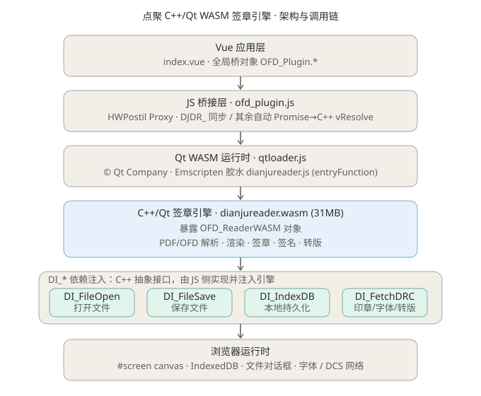
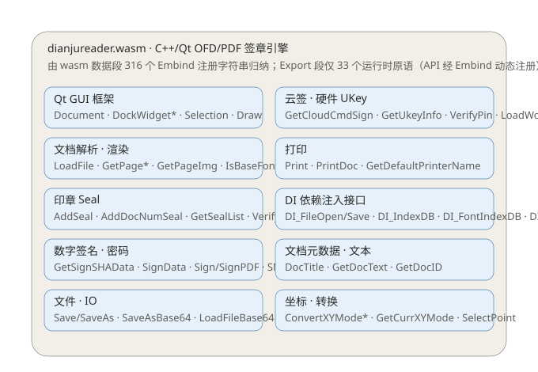
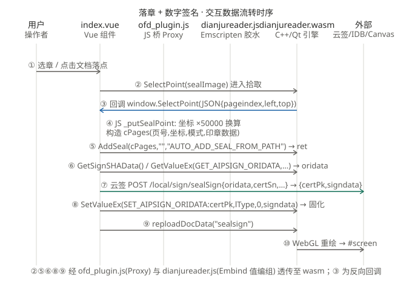

# 点聚 C++/Qt WASM 签章引擎 · 功能域与交互时序分析

> 分析对象：`D:\workspace\front-new\dianju-ui-admin\src\views\wasmSeal\index.vue`
> 胶水层：`D:\workspace\front-new\dianju-ui-admin\public\wasm\dianjureader.js`
> 引擎：`D:\workspace\front-new\dianju-ui-admin\public\wasm\dianjureader.wasm`（31 MB）
> 桥接：`D:\workspace\front-new\dianju-ui-admin\public\wasm\ofdwebsdk\ofd_plugin.js`
> 分析日期：2026-10-16 · 分析方法：源码阅读 + WebAssembly 静态段解析（REA 原生提供器不支持 wasm，改用直接 Section 解析）

---

## 摘要（结论先行）

`index.vue` **本身不实现任何签章算法**。它调用的是点聚（Dianju）的 **C++/Qt 版式文档签章引擎**，该引擎经 Emscripten 编译为 WebAssembly（`dianjureader.wasm`，31 MB），由 Vue 组件通过全局桥对象 `OFD_Plugin` 驱动。

其架构本质是 **"前端编排 + wasm 引擎承载算法"**：

- 前端（Vue）只负责**数据搬运与坐标换算**——把落章坐标、待签原文、外部签名结果在 Vue、wasm 引擎、云端/硬件之间传递；
- 真正的文档解析、渲染、印章拼装、签名固化都在 `dianjureader.wasm` 的 C++/Qt 引擎里；
- 签名密钥始终留在安全侧（云端 / UKey 硬件），**私钥永不进入 wasm**。

---

## 一、引擎技术构成（证据）

| 证据 | 位置 | 说明 |
|---|---|---|
| `Copyright (C) 2023 The Qt Company Ltd.` | `public/wasm/qtloader.js:1-2` | Qt 官方 WebAssembly 加载器，导出 `qtLoad()` |
| `var dianjureader_entry = (() => {...})` | `dianjureader.js` 头部 | Emscripten MODULARIZE 入口函数 |
| 全文件 1231 处 `emscripten` | `dianjureader.js` | 标准 Emscripten 胶水层 |
| `dianjureader.wasm` 31 MB | `public/wasm/` | 真正的 C++/Qt 编译产物 |
| `OFD_ReaderWASM`、`AddSeal`、`GetSignSHAData` 等 | wasm 数据段（Embind 注册字符串） | 引擎对外暴露的 C++ 方法名确证存在 |

**静态段解析结论（wasm 字节码）：**

- 头部 `magic = 0x0061736d`，`version = 1`，体积 31,619,962 字节；
- **Export 段仅 33 个符号**，且全是运行时原语（`malloc`/`free`/`pthread_*`/`__cxa_*`/`emscripten_thread_*`），**没有** `dianjureader_entry`、`OFD_ReaderWASM`、`AddSeal`；
- **name 段为空**（release 版已剥离符号）；
- 因此引擎 API 是经 **Embind 在运行时动态注册**进 JS `Module` 对象的，不出现在静态表里；功能表面由数据段内的 316 个 Embind 注册字符串还原（见第三章）。

**导入段（引擎如何与外界交互）：** 549 个导入、548 个导入函数，模块 `env`(540) + `wasi_snapshot_preview1`(9)。关键导入直接暴露能力：

- `env._embind_register_class / _class_function / _function / _integer …` → 用 Embind 把 C++ 类（如 `OFD_ReaderWASM`）和方法注册给 JS；
- `env._emval_*`（39 个）→ emscripten 值桥（C++↔JS 对象互传），即 JS 桥 Proxy 调 C++ 的底层机制；
- `env.emscripten_webgl_*` → Qt 界面走 **WebGL canvas** 渲染（对应 `#screen`）；
- `env.emscripten_websocket_*` + `emscripten_fetch_*` + `getaddrinfo` → **引擎在 wasm 内部直接联网**（印证 `reader_config.ini` 的字体/DCS 外网地址）；
- `env.emscripten_idb_*` → **引擎在 wasm 内部直接读写 IndexedDB**（印证 `DI_IndexDB` 持久化）。

---

## 二、架构与调用链

调用链分五层（自上而下）：

1. **Vue 应用层**（`index.vue`）：调用 `OFD_Plugin.*` 全局桥对象。
2. **JS 桥接层**（`ofd_plugin.js`）：`HWPostil` Proxy 转发——`DJDR_` 前缀方法**同步**直调 C++；其余方法自动包成 **Promise**，把 `resolve` 作为回调传给 C++ 的 `vResolve` 异步版本。
3. **Qt WASM 运行时**（`qtloader.js` + `dianjureader.js`）：`qtLoad({ qt:{ entryFunction: window.dianjureader_entry, containerElements: screens }})` 实例化 Qt WASM 应用，渲染进 `#screen`。
4. **C++/Qt 签章引擎**（`dianjureader.wasm`）：暴露 `OFD_ReaderWASM` 对象，承载解析 / 渲染 / 签章 / 签名 / 转版。
5. **浏览器运行时**：`#screen` canvas、IndexedDB、文件对话框、字体/DCS 网络。

其中 **DI_\* 依赖注入**（C++ 抽象接口、由 JS 侧 `di_*.js` 实现并注入）是耦合关键：`DI_FileOpen`/`DI_FileSave`/`DI_IndexDB`/`DI_FetchDRC` 让纯 wasm 二进制能使用浏览器文件系统、IndexedDB、网络资源。**wasm 二进制 + JS 桥 + 4 个 di 脚本是整体，缺一不可。**

---

## 三、功能域总览（index.vue 借 wasm 实现的能力）

> 下表方法均来自 `index.vue` 的 `OFD_Plugin.*` 调用，且已在 wasm 数据段以 Embind 注册字符串确证存在。

| 功能域 | index.vue 调用的 wasm 方法（经 `ofd_plugin.js` 桥接） | 作用 |
|---|---|---|
| **引擎生命周期** | `_InitApplication('#spinner','#screen','#status')`、`_IniCtrlReadytCallback(cb)`、`CloseDoc(0)`、`_DestroyApplication()`、`registListener(...)` | 启动 Qt WASM 应用、渲染进 `#screen`、绑定 `window.SelectPoint`/`PageIndex` 回调、销毁 |
| **文档打开·渲染** | `LoadFile(file)`、`GetCurrFileSize()`、`GetPageCount()`、`GetPageWidth/Height(pageindex)`、`SetPageMode(mode,val)`、`SetCurrPage(n)`、`getDocProperty/SetDocProperty`、`getFileMd5Value`、`getSignaturesCount('seal')`、`IsOpened()` | 解析 PDF/OFD、取页数/尺寸、设显示模式、算文档指纹与已签数 |
| **印章 Seal** | `SelectPoint(sealImage)`、`AddSeal(cPages,"","AUTO_ADD_SEAL_FROM_PATH")`、`GetReValue("")`、`GetValue("GET_LAST_SEAL")`+`DeleteNote(ret)`、`GetCreateSeal(...)`、`GetSealImage/GetSealData/GetSealListJson`、`SetValue("SET_JMJSERVER_GMCERTDATA",cert)` | 进入落章交互、把印章加进文档、撤销上一章、造 RSA 章、取印章图像/数据 |
| **数字签名（外部算）** | `GetSignSHAData()`、`GetValueEx("GET_AIPSIGN_ORIDATA",type,"",0,"")`、`GetDocType()`、`SetValueEx("SET_AIPSIGN_ORIDATA:"+certPk,lType,0,signdata)`、`GetErrorString(ret)`、`reploadDocData("sealsign")` | 取待签原文（RSA/P7 或 SM2）、判断文档类型、回灌签名+证书并**固化**、刷新渲染 |
| **UKey / 硬件** | `GetUkeyInfo(1)`、`VerifyPin(pin)`、`SetValue("SET_SKFKEY_PIN",pin)`、`GetValue("GET_CURRENT_CERT")` | 读 UKey、校验 PIN、取当前证书（硬件内签） |
| **保存 / 转版** | `SaveTo("","fileFormat",0)`、`openFile_Back/saveTo_Back/closeFile_Back/getFileInfo`、`ShowDialog(...)` | 保存、后台打开做 PDF↔OFD 转版、文件对话框 |
| **视图 / 工具栏 GUI** | `performClick("view_zoomin"/"doc_clockpage"/...)`、`SetShowToolBar(0)`、`SetCurrAction(0/2)`、`GetCurrAction()`、`SearchText`、`GetNextNote(...)`、`Undo/Redo/CanRedo` | 缩放、翻页、显隐 UI、交互模式、文本搜索、遍历批注、撤销重做 |
| **模式 / 格式配置** | `SetValue("ADD/DEL_FORCETYPE_VALUE8/VALUE7",...)`、`SetValue("SET_JAVA_SM2MODE","1/0")`、`SetValue("SET_PDFSEAL_ALPHA","180")`、`SetSealMode(1)`、`setSingleMode(true)` | 国办/P7 强制类型、SM2/RSA 模式、PDF 印章透明度、外部签名模式 |

**引擎内部功能模块（由 316 个 Embind 字符串归纳）：** Qt GUI 框架（`Document`/`DockWidget*`/`Selection`/`Draw`）、文档解析·渲染、印章、数字签名·密码（`SM2`/`SM3`/`RSA`/`P7`）、文件·IO、云签·硬件 UKey、打印、DI 依赖注入接口、文档元数据·文本、坐标·转换。

> 印证：引擎内部已处理 **CID 中文字体**（`IsBaseFont`/`IsCIDFont`），与本项目 `rust-wasm-seal` 要解决的中文空白问题是同一类问题。

---

## 四、交互时序：落章 + 数字签名（核心交互）

以**落章 + 数字签名**这一最核心交互为例，数据在各层间流动如下：

1. **①** 用户在界面选章并点击文档落点 → Vue 收到。
2. **②** Vue 调 `SelectPoint(sealImage)` → 经 `ofd_plugin.js`（Proxy 转发）和 `dianjureader.js`（Emscripten+Embind 值编组）进入 wasm，引擎切换为"落章拾取"模式。
3. **③** 引擎捕获鼠标落点，**反向回调** `window.SelectPoint(JSON{pageindex,left,top})` → Vue 的 `_putSealPoint`。
4. **④（Vue 内部）** `_putSealPoint` 用页面宽高把像素坐标换算成 **50000 坐标系**（`floor(left/width*50000)`、`floor(top/height*50000)`），拼出 `cPages` 串（页号,坐标,模式,印章数据）。
5. **⑤** Vue 调 `AddSeal(cPages,"","AUTO_ADD_SEAL_FROM_PATH")` → wasm 把印章写进文档，返回 `ret`（≠0 成功）。
6. **⑥** Vue 调 `GetSignSHAData()` 或 `GetValueEx("GET_AIPSIGN_ORIDATA",...)` → wasm 计算并返回**待签原文/哈希** `oridata`（RSA/P7 取 `GetSignSHAData`；SM2 取 `GetValueEx` 的 type 3=P7 / 2=国办）。
7. **⑦** Vue 把 `oridata` 发到云端 `POST /local/sign/sealSign`（云签）；UKey 场景则走 wasm `SignData` 在硬件内签——**私钥永不离开安全侧**。
8. **⑧** Vue 拿到 `{certPk, signdata}`，调 `SetValueEx("SET_AIPSIGN_ORIDATA:"+certPk,lType,0,signdata)` → wasm 把签名值+证书写回 PDF/OFD 签名字典并**固化**。
9. **⑨** Vue 调 `reploadDocData("sealsign")` → wasm 重算文档。
10. **⑩** wasm 通过 **WebGL** 把已签章页面重绘到 `#screen`，用户看到落章+签名结果。

> 说明：②③⑤⑥⑧⑨ 的调用经 `ofd_plugin.js(Proxy)` 与 `dianjureader.js(Embind 值编组)` 透传至 wasm；③ 为 wasm 经同一路径反向回调 JS。

---

## 五、其它交互阶段

- **初始化**：`window.Module` 注入 → `_IniCtrlReadytCallback` → `_InitApplication` → `qtLoad` 实例化 Qt WASM → `NotifyCtrlReady` 后 `OFD_ReaderWASM.GetGlobalInstance` 入表。
- **打开文档**：`LoadFile` → `GetPageCount/Width/Height` → `SetPageMode` 显示。
- **保存/转版**：`SaveTo` 或 `openFile_Back`→`saveTo_Back`→`closeFile_Back`（PDF↔OFD 互转）。
- **撤销/视图**：`GetValue("GET_LAST_SEAL")`+`DeleteNote` 撤销章；`performClick` 触发 Qt 工具栏动作。

---

## 六、安全与架构要点

1. **私钥永不进入 wasm**：云签走 `GetCloudCmdSign`/服务端，UKey 走 `VerifyPin`/`LoadWorkKey` 硬件内签，签名结果再回灌引擎固化。
2. **联网与持久化都在 wasm 内**：字体下载、DRC 拉取、IndexedDB 缓存由 C++ 直接发起——意味着 `reader_config.ini` 里的外网地址（`47.94.147.6:8085/DCS`、`47.105.58.8:8090` 字体服务）会从 wasm 内访问，**安全审计时要计入数据外发风险**。
3. **密码算法**：字符串确证支持 `SM2`/`SM3`/`RSA`/`P7`（国密 + 国际 + PDF P7 签名）。
4. **双格式**：`DoubleOFD`、`GetDocType`、`GetCurrDocType` 表明同时支持 PDF 与 OFD。

---

## 七、证据索引

- 引擎文件：`public/wasm/dianjureader.wasm`、`public/wasm/dianjureader.js`、`public/wasm/qtloader.js`、`public/wasm/ofdwebsdk/ofd_plugin.js`
- 配置与资源：`public/wasm/drc/drc.js`、`public/wasm/drc/config/reader_config.ini`、`public/wasm/drc/seals/djofd_wasm.sel`
- 调用方：`src/views/wasmSeal/index.vue`
- 本分析附图：`architecture.svg`、`functional-modules.svg`、`interaction-sequence.svg`
- 可复现解析脚本（位于 `public/wasm/`）：`__rea_wasm_parse.cjs`（wasm 段解析）、`__rea_wasm_api_strings.cjs`（API 字符串提取）

## 八、分析方法说明

REA 原生提供器（auto / JEB / Ghidra）对 WebAssembly 均返回 `unsupported binary format`（其 Ghidra 无 wasm loader）；REA 的 web 工具需本地 Chrome + CDP 实时会话，不能直接吃文件。故改用**直接解析 WebAssembly 字节码 Section** 的方式还原引擎功能表面，证据可复现，详见第七章脚本。
